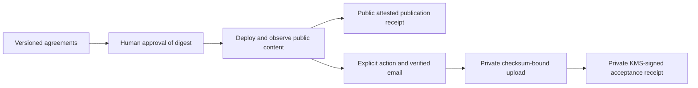

# 1. Bind agreement receipts to approved content

Date: 2026-11-27

## Status

Accepted for implementation. Production deployment and effective-date approval
remain separate operator actions.

## Context

A successful build does not demonstrate publication, and publication does not
demonstrate individual acceptance. Personal acceptance records introduce new
privacy obligations. The company needs portable evidence without adding a
commercial signing platform or an account system to local Savior use.

## Decision

Build legal pages from one versioned source and an explicit publication
allowlist. Bind human approval to a manifest digest, attest the exact build,
deploy that artifact, and verify public HTTPS bytes. Store a public publication
receipt and archive versions independently of expiring Actions artifacts.

Use an optional AWS receipt service for explicit, email-verified actions.
Short-lived capabilities authorize checksum-bound, create-only S3 uploads.
Lambda validates uploaded bytes, commits acceptance transactionally with the
closure boundary, and uses KMS to sign a portable receipt. SES delivers proof of
mailbox control; DynamoDB owns expiry, replay, idempotency, and closure state.
Recovery completes a committed action without recording a second acceptance.

Publishing plain Markdown alone is sufficient for reading, but provides no
explicit content-bound approval or publication observation. CI artifacts alone
expire. A managed signing platform would reduce custom service operation but
add another processor and commercial integration. An email link alone proves
neither an acceptance action nor legal identity. The chosen design preserves
public reading without an account and keeps individual evidence private, at
the cost of operating verification, cleanup, and signing infrastructure.

## Invariants & Abstention

- Publishing, reaching a declared date, identity assurance, and legal
  enforceability are distinct claims. A missed deadline cannot be backdated.
- Terms acceptance cannot enable analytics or restrict existing AGPL rights.
- Unknown facts, missing evidence, stale approval, public-content mismatch,
  unavailable verification, and invalid uploads block the relevant operation.
- Opening an email link alone does not accept anything. Verification binds a
  purpose, mailbox, exact document, expiry, and explicit subsequent action.
- Public receipts contain no individual acceptance data. Private application
  logs exclude email, content, tokens, and upload/download capabilities.
- Closing prevents uncommitted acceptance and starts three calendar years of
  retention for existing signed records. Pending unsigned work is discarded.
- Temporary-state expiry is enforced in application logic; asynchronous TTL or
  lifecycle cleanup never serves as the authorization boundary.

## Consequences

Receipts can be independently checked against published verification keys.
The service has a small usage-based footprint plus a KMS key charge, but adds
AWS operations, abuse prevention, and private-record retention duties. AWS and
account administrators remain in the trust boundary. The design establishes
neither owner-only encryption nor verified legal identity or notarization.
