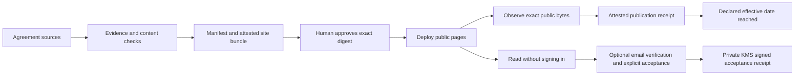

# Agreement adoption and release

The four sources in `legal/` are agreements prepared for adoption, without draft
labels or editorial placeholders. They have no effective date until an approved
release supplies one. Internal critiques and unresolved evidence stay here and
are excluded from the public build. Contact is `support@yourmood.ai`; no physical
address is published.

## Publication and acceptance



A publication receipt establishes which content was approved and observed, at
which revision and time. Its effective-date status only reports whether the
declared date has arrived. Neither establishes legal enforceability, compliance,
or individual assent. An individual receipt records an explicit action by a
person controlling a mailbox; it is not verified legal identity or notarization.
Reading a page, opening an email, or using AGPL software does not record assent.

## Decisions before adoption

`adoption.json` deliberately starts with every evidence check pending. A check
requires `status: verified`, a named `reviewer`, UTC `checked_at`, and one or more
evidence entries containing a repository-relative `path` and its `sha256`.
Use reviewed, sanitized evidence; never commit mailboxes, credentials, private
receipts, tokens, signed upload URLs, or unredacted customer requests. Describe
restricted supporting records by reference in the sanitized report.

| Check | Evidence needed |
| --- | --- |
| `company_facts` | Confirm legal entity and incorporation jurisdiction; public contact remains email only. |
| `email_operations` | Confirm monitored contact, actual provider, security/access configuration, and deletion procedure. DNS alone does not prove a provider contract. |
| `retention_operations` | Demonstrate closed support deletion after 90 days, receipt closure and three-calendar-year expiry, and provider backup limits. |
| `jurisdiction_review` | Determine applicable privacy/consumer obligations, legal basis and rights routes, and whether email-only contact meets the actual obligations. Do not invent an address or jurisdiction. |
| `licensing_audit` | Review rights/provenance, dependency terms and actual distributed artifacts. Current code and official artifacts remain AGPL; no commercial binary offer is activated. |
| `privacy_runtime` | Bind passing tests and the actual shipped Savior revision to default-off history and the documented coverage limits. |
| `receipt_live_verification` | Verify real delivery, verification, upload, KMS signature, retrieval, closure and cleanup using a separate synthetic test registry and isolated test stack. Offline tests do not establish live operation. |

Do not mark these checks verified simply to permit publication. The service
template and tests prepare an implementation; they do not establish live AWS or
mailbox behavior. The initial live check uses synthetic test agreements in an
isolated stack, avoiding a dependency on an already effective production policy.
Never activate the production registry using an unpublished candidate.

## Evidence map

- [Privacy critique](privacy-critique.md): selected readings and the original
  behavior observed at Savior revision `a8650cd`; historical findings remain
  distinguishable from the subsequent consent fix.
- [Licensing audit](licensing-audit.md): declared source licenses, packaging
  boundaries, and unresolved rights/notice questions. Run its inventory command
  against the exact revision and artifact intended for distribution.
- Savior `docs/adr/0013-require-consent-for-all-trace-history.md`: no new trace
  outcomes without current history consent. Existing records need separate
  deletion or expiry; plaintext storage is not encryption.
- [Receipt architecture](../adr/0001-bind-agreement-receipts-to-approved-content.md):
  integrity, publication, acceptance, and abstention boundaries.
- `tests/`: synthetic domain/cryptographic tests and release-gate checks;
  `infra/receipts/template.yaml`: proposed deployment configuration.

## Prepare AWS separately

The authorized target is profile `awill`, account `463509296941`, region
`us-east-1`. The last preflight encountered expired SSO. Do not reuse another
profile or copy credentials. Refresh the configured session through the normal
operator flow, then verify:

```sh
AWS_PROFILE=awill AWS_REGION=us-east-1 aws sts get-caller-identity
```

The account must match before any mutation. Deployment, SES production access,
sender authorization, and any DNS changes are separate operator actions. Use an
existing authorized SES identity; do not assume the support mailbox is verified
for SES or change its MX records. The template refuses another account/region.

When deployment is authorized, with AWS SAM installed:

```sh
AWS_PROFILE=awill AWS_REGION=us-east-1 sam build --template-file infra/receipts/template.yaml
AWS_PROFILE=awill AWS_REGION=us-east-1 sam deploy --guided
```

Supply `VerificationFrom` and the existing `SenderIdentityArn`; review the
generated change set before executing it. The template retains the bucket,
table, and signing key when the stack is deleted. Stack deletion is not data
deletion. Configure alarms and a privileged-access review before real use.

After deployment, run the configuration preflight and export only the public key:

```sh
AWS_PROFILE=awill AWS_REGION=us-east-1 uv run --python 3.12 --with-requirements requirements.txt python scripts/receipts_admin.py inspect --stack YOUR_STACK --sender YOUR_VERIFIED_SENDER
AWS_PROFILE=awill AWS_REGION=us-east-1 uv run --python 3.12 --with-requirements requirements.txt python scripts/receipts_admin.py export-key --stack YOUR_STACK
```

Review and commit the public key catalogue before a release. Retain old public
keys for old receipt verification; rotation must not replace their identity.
An infrastructure preflight checks configuration, not end-to-end delivery or
legal readiness. Record the separate synthetic live test in adoption evidence.

The service uses a private, versioned S3 bucket, DynamoDB, Lambda, SES and an
asymmetric KMS signing key. It has ongoing key charges and usage-based email,
storage, request and log charges; it is not free. Confirm current AWS pricing
and budgets before deployment. The single signing key and service role are a
small-service design, not separation from every infrastructure administrator.
AWS encryption at rest is not end-to-end encryption.
The role permits the underlying item operations and `ConditionCheckItem` required
by [DynamoDB transaction authorization](https://docs.aws.amazon.com/amazondynamodb/latest/developerguide/transaction-apis-iam.html);
the transaction API name alone is not the permission boundary.

## Approve and publish

1. Configure Pages with GitHub Actions as its source **before merging**. Create
   `legal-publication` with at least one required reviewer and administrator
   bypass disabled. Preserve an independent human approval path.
2. Resolve and commit adoption evidence and public keys. Run `make check`,
   `make test`, and `make infrastructure-check`. Review changes in both the
   company repository and Savior. Use a clean, exact revision on `main`.
3. Dispatch `publish approved agreements` with a unique `release_id`, a future
   UTC `effective_at` ending in `Z`, and the deployed receipt API URL. Leave
   sufficient room for review and propagation; a missed deadline fails rather
   than backdating the observation.
4. Review the generated `legal-release` artifact: the site, manifest, evidence
   digest, document versions, date, API and key. Approve `legal-publication`
   using the exact comment shown in the run summary: `approve legal <sha256>`.
   Approval of different content is rejected.
5. The workflow verifies provenance, deploys the existing Pages artifact and
   observes each public asset's exact digest. It retries propagation failures
   within a bounded window and refuses a late observation. It attests the
   publication receipt and creates release `legal-<release_id>` containing the
   site bundle, manifest, approval, receipt, and verification bundles. A later
   release is blocked until the current published version is archived locally.

Do not treat a deployment failure after upload as proof the site is unchanged.
Inspect Pages and the failed run. A correction needs a newly reviewed release
and an honest future date; never overwrite a version or backdate a receipt.

Download a release's public evidence and verify it, using the source commit from
the independently reviewed release:

```sh
gh release download legal-RELEASE_ID --repo yourmoodai/yourmoodai.github.io --dir .cache/released
gh attestation verify .cache/released/site.tar.gz --bundle .cache/released/build.attestation.jsonl --repo yourmoodai/yourmoodai.github.io --signer-workflow yourmoodai/yourmoodai.github.io/.github/workflows/legal-release.yml --source-digest REVIEWED_SOURCE_COMMIT --source-ref refs/heads/main
gh attestation verify .cache/released/manifest.json --bundle .cache/released/build.attestation.jsonl --repo yourmoodai/yourmoodai.github.io --signer-workflow yourmoodai/yourmoodai.github.io/.github/workflows/legal-release.yml --source-digest REVIEWED_SOURCE_COMMIT --source-ref refs/heads/main
gh attestation verify .cache/released/publication-receipt.json --bundle .cache/released/publication.attestation.jsonl --repo yourmoodai/yourmoodai.github.io --signer-workflow yourmoodai/yourmoodai.github.io/.github/workflows/legal-release.yml --source-digest REVIEWED_SOURCE_COMMIT --source-ref refs/heads/main
uv run --python 3.12 --with-requirements requirements.txt python scripts/legal.py effective --receipt .cache/released/publication-receipt.json
```

The last command also verifies the receipt through GitHub before reporting
`scheduled` or `declared_effective_date_reached`. Preserve independent copies of
the public evidence and verification bundles; release assets can be deleted by
repository administrators. They provide tamper detection, not immutable hosting.

## Activate and operate private receipts

Restore the exact released site into `public/` and retain its downloaded
`manifest.json` and `publication-receipt.json`. After the public release is
verified, an authorized operator can activate its exact registry:

```sh
AWS_PROFILE=awill AWS_REGION=us-east-1 uv run --python 3.12 --with-requirements requirements.txt python scripts/receipts_admin.py activate-registry --stack YOUR_STACK --manifest .cache/released/manifest.json --publication-receipt .cache/released/publication-receipt.json --approve-manifest REVIEWED_MANIFEST_SHA256
```

The command checks the current public manifest, publication provenance, deployed
API and published public key. Acceptance remains unavailable until the declared
date arrives. Test the activated production flow with an authorized test mailbox
and synthetic content; do not claim live operation from the offline test suite.
No production activation has been performed by preparing this change.

Recipients use `/legal/receipts/` to request acceptance, retrieval, or closure.
Email links expire after 15 minutes. Opening them verifies a capability but does
not accept terms. Acceptance requires confirmation and uploads only the
server-issued content-bound payload. The service verifies actual uploaded bytes
before signing. Uploads are conditional, short lived bearer capabilities, not
proof of identity. Receipt URLs expire after two minutes and are scoped to the
verified mailbox. Tokens stay out of query strings, logs, and browser storage.

Verify a downloaded private receipt with a previously trusted public key and
its expected KMS key ARN, rather than trusting a key supplied by the receipt:

```sh
uv run --python 3.12 --with-requirements requirements.txt python scripts/legal.py verify-receipt --receipt /PRIVATE_PATH/acceptance-receipt.json --public-key legal/keys/TRUSTED_PUBLIC_KEY.pem --key-id TRUSTED_KMS_KEY_ARN
```

The command verifies the signature and basic receipt type. Compare the payload's
agreement digest and archived URL with the independently verified public
manifest. A valid signature does not establish that an agreement is enforceable.
Keep private receipts out of Git and CI artifacts.

Closure stops pending acceptance and starts three-calendar-year retention for
signed receipts. Daily cleanup removes expired receipts and **all S3 versions**;
it recovers committed finalizations without creating a new acceptance action.
Challenges/rate counters have separate short TTLs. Monitor cleanup errors and
verify deletion; DynamoDB TTL and S3 lifecycle are asynchronous and are not proof
of exact-time erasure. Logs exclude content and capabilities and expire after
seven days. Provider security records and backup cycles have separate limits.

## Later revisions

Archive the verified release before changing its pages:

```sh
uv run --python 3.12 --with-requirements requirements.txt python scripts/legal.py archive --site public --receipt .cache/released/publication-receipt.json
```

Review and commit `legal/history/`. Later builds copy its verified frozen pages
and styles, preserving version URLs and digests. Increment affected agreement
versions and choose a new release ID; never reuse an archived ID. Repeat
adoption review when practices or facts change. A new publication or analytics
purpose does not silently expand prior acceptance or consent.
